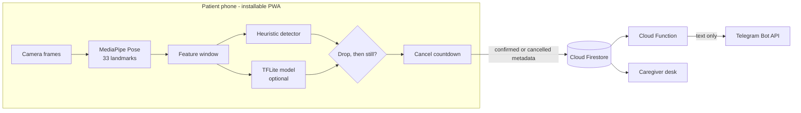
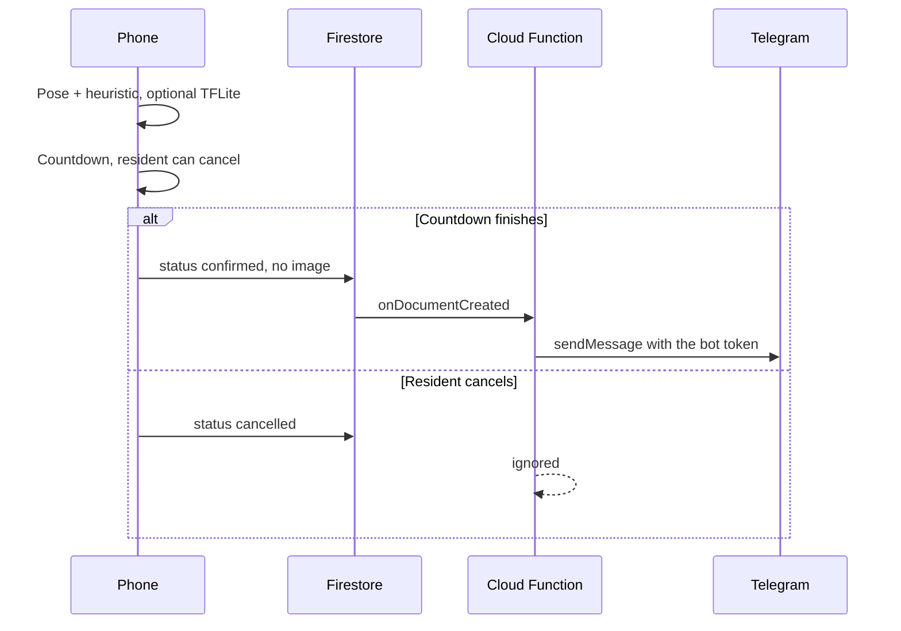

# KinAlert

Smartphone fall detection for an M.Tech prototype. A React progressive web app watches a person with the phone camera, tracks a 33-point skeleton **on the device**, and decides whether they have fallen. A caregiver desk shows the event log. Confirmed events can page someone on Telegram.

Video frames are not stored and are not uploaded. The pose model and the optional fall model run in the browser. The only thing written to the server is a short event: time, confidence, resident and device ids, and a few numbers that describe the drop.

This is a demonstration. It is not a medical device.

## Architecture





The camera is assumed to be a phone propped at table or chest height, looking across the room. A ceiling camera does not match the “down in the image” rule.

## What is in the repo

| Path | Role |
| --- | --- |
| `src/domain/heuristic.ts` | Drop velocity, torso angle, body-box shape, stillness window |
| `src/domain/session.ts` | Uses the TFLite score when a model is loaded, otherwise the heuristic |
| `src/domain/feature_contract.json` | Window length and channel order shared with training |
| `src/services/pose.ts` | MediaPipe Pose Landmarker |
| `src/services/model.ts` | Loads `/models/fall_detector.tflite` with LiteRT.js |
| `src/components/MonitorScreen.tsx` | Camera, skeleton, simulation, cancel countdown |
| `src/components/CareScreen.tsx` | Live caregiver log |
| `functions/` | Firestore trigger that sends the Telegram message |
| `training/train_fall_model.py` | Keras training script, exports `.tflite` |
| `firestore.rules` | Rejects image fields and anything outside the event schema |

## Run it locally

Requirements: Node.js 22, npm. Java 21 is needed only for the Firestore emulator. Python 3.12 is needed only to retrain the model.

```bash
npm install
npm test
npm run dev
```

Open [http://127.0.0.1:4317](http://127.0.0.1:4317).

1. On **Phone watch**, press **Fall and lie still**.
2. The skeleton drops. After about a second of stillness a countdown starts.
3. **Cancel false alarm** writes a cancelled event. Letting the timer finish writes a confirmed fall.
4. Open **Caregiver desk** to see the event.

The other scenarios (stumble, slow sit, bend, quiet standing) show motion that should not alert.

`npm run dev` reads `.env.development`. That file points at the Firestore emulator with placeholder keys, not a real Firebase project. If the emulator is not running, events stay in this browser and the desk still shows them. The page says which of the two is happening.

### Firestore emulator

```bash
npm install --prefix functions
npm run emulators:firestore
```

Leave that terminal open, then refresh the app. Confirmed and cancelled events are written to `fallEvents`. The emulator UI is at [http://127.0.0.1:4401](http://127.0.0.1:4401).

To run the Telegram function on your machine as well:

```bash
cp functions/.env.example functions/.env
# edit functions/.env — see Telegram below
npm run emulators
```

Without a real token the function logs that Telegram is not configured and marks the document `skipped_unconfigured`. It does not throw, and it does not send a message for cancelled events.

## Camera and install

**Use camera** asks for permission and draws the skeleton on the preview. The front camera is mirrored so the joints sit on the person. Pose weights are downloaded once from Google’s MediaPipe host; the frames themselves are not sent.

The app is a PWA (`vite-plugin-pwa`). A production build can be installed from Chrome: **Add to Home screen** / **Install app**. The dev server does not register a service worker, so install from `npm run build && npm run preview`.

iOS needs a user gesture before the camera starts, and the page must be served on HTTPS or localhost. The video element is `playsInline` so it does not jump to fullscreen.

## Firebase project

1. Create a project in the [Firebase console](https://console.firebase.google.com/).
2. Create a **Cloud Firestore** database in native mode.
3. Register a web app and copy the config.
4. Copy `.env.example` to `.env.local` and fill in the `VITE_FIREBASE_*` values. Set `VITE_USE_FIREBASE_EMULATOR=false`.
5. Log in and select the project:

```bash
npx firebase login
npx firebase use --add
```

6. Deploy rules, functions, and hosting:

```bash
npm run build
npx firebase deploy --only firestore:rules,functions,hosting
```

Rules in this prototype allow reads and validated creates without Firebase Auth, so a demo works before you add accounts. Before any real deployment, require authentication and restrict each resident’s documents to their caregivers. The rules already refuse image, video, and landmark fields.

The hosting rewrite serves the single-page app from `dist`.

## Telegram bot

The bot token is never put in the frontend. The Cloud Function reads it from the environment.

1. In Telegram, open [@BotFather](https://t.me/BotFather).
2. Send `/newbot`.
3. Choose a display name, for example `KinAlert Caregiver`, and a username ending in `bot`.
4. BotFather replies with a token that looks like `123456789:AA...`. Put it in `functions/.env` as `TELEGRAM_BOT_TOKEN`.
5. Open the bot chat and send it any message, such as `hello`. For a group, add the bot to the group and send a message there.
6. Visit `https://api.telegram.org/bot<token>/getUpdates` in a browser. Copy the numeric `chat.id` (group ids are negative) into `TELEGRAM_CHAT_ID`.

For production, store those values as secrets instead of a file:

```bash
npx firebase functions:secrets:set TELEGRAM_BOT_TOKEN
npx firebase functions:secrets:set TELEGRAM_CHAT_ID
```

If you switch to secrets, bind them on the function with `secrets: [TELEGRAM_BOT_TOKEN, TELEGRAM_CHAT_ID]` from `firebase-functions/params`. The handler already reads `process.env`, which is how both `.env` and bound secrets are exposed at runtime.

The message is plain text: resident, device, confidence, time, hip speed, torso angle, and a line that no image was sent.

## Train and export the model

The app looks for `public/models/fall_detector.tflite`. A small synthetic model is already checked in (`synthetic-v1`), so the TFLite path is active on a fresh clone. If that file is missing or the runtime fails, the heuristic decides on its own. If the file loads, its probability replaces the heuristic confidence, and a score under `0.5` vetoes the alert.

Browser runtime: [LiteRT.js](https://ai.google.dev/edge/litert/web) (`@litertjs/core`), which is the current name of TensorFlow Lite on the web. `@tensorflow/tfjs-tflite` is an old alpha pinned to `tfjs-core` 4.9.0 and is not used.

```bash
npm run fixtures
cd training
python3 -m venv .venv
source .venv/bin/activate
pip install -r requirements.txt
python train_fall_model.py
```

`npm run fixtures` writes `training/fixtures/windows.json` by running the same scenarios the UI plays and sampling the feature window at the moment the heuristic confirms (or at the end, for non-falls). The Python script trains a small Conv1D network on synthetic windows plus jittered copies of those fixtures, checks that the fall fixture scores high and the other fixtures score low, and writes:

- `public/models/fall_detector.tflite`
- `public/models/model_info.json`

Input shape is `[1, 24, 6]`: 2.4 seconds at 10 Hz. Channels, in order: `hipY`, `hipVy`, `torsoAngleNorm`, `aspect`, `motion`, `trunkLength`. See `src/domain/features.ts`.

### UR Fall Detection and Le2i

The shipped weights are **not** trained on real falls. To replace them:

1. **UR Fall Detection** (University of Rzeszów): RGB-D, depth, and accelerometer clips of falls and daily activities. Dataset page: <http://fenix.univ.rzeszow.pl/~mkepski/ds/uf.html>.
2. **Le2i Fall Detection** (Université de Bourgogne): videos in a home, coffee room, office, and lecture room. Use the copy your institution provides.

For either set, run MediaPipe Pose offline on the RGB frames, compute the six features with the same definitions, and cut 24-step windows. Label a window `1` when a fall occurs inside it and the person is on the floor at the last step. Save one window per CSV row: `label` followed by `24 × 6` values in channel order. Then:

```bash
python train_fall_model.py --csv /path/to/windows.csv
```

Do not commit the videos or a model you are not allowed to redistribute.

## Tests

```bash
npm test
```

Vitest covers the heuristic (fall, sit, bend, stumble, standing, missing person), the model veto and fallback, the metadata whitelist, and the Telegram decision helper in `functions/alert.js`.

## Privacy checklist

- Frames are passed to MediaPipe and then dropped. There is no `MediaRecorder`, no canvas upload, and no image field in the event.
- The landmark history is a few seconds long and stays in memory.
- `buildFallEvent` copies a fixed set of fields. `assertMetadataOnly` rejects arrays and image-like keys before a write.
- Firestore rules repeat that restriction.
- The Cloud Function skips cancelled events and any document that still contains a forbidden key.

## Limits worth saying in a viva

- One person, side or front view, phone roughly upright. Occlusion and a second person in frame are not handled.
- The heuristic wants a rapid drop and a still period. Someone who falls and keeps moving may alert only when the deadline expires, and only if they are still lying down.
- The checked-in network, when present, has only seen synthetic motion that matches this simulator.
- The countdown is local. Closing the tab during the countdown sends nothing.
- Prototype security rules are open for reads. Add Auth before real use.
